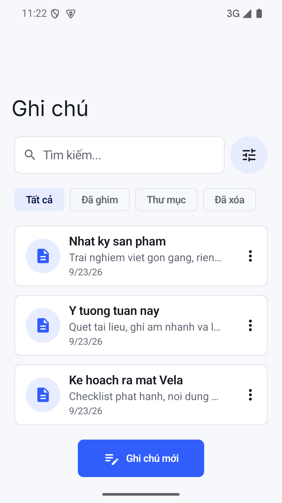
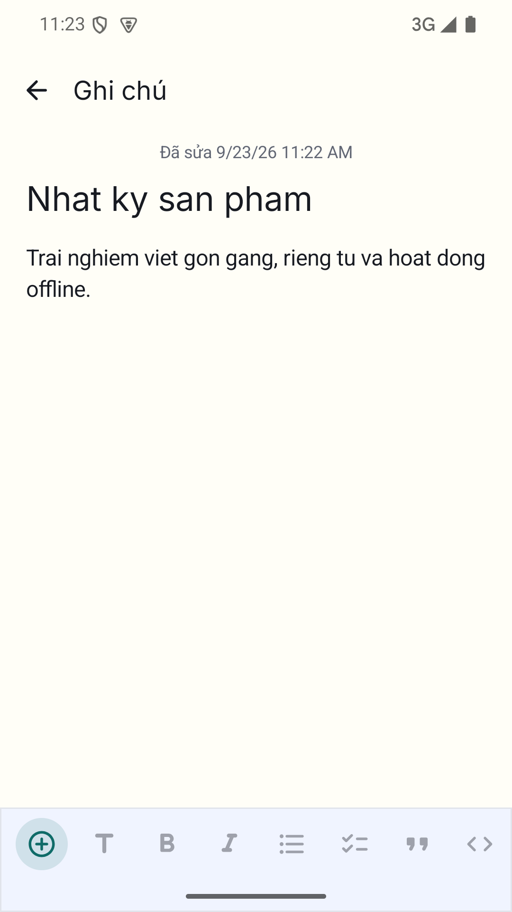
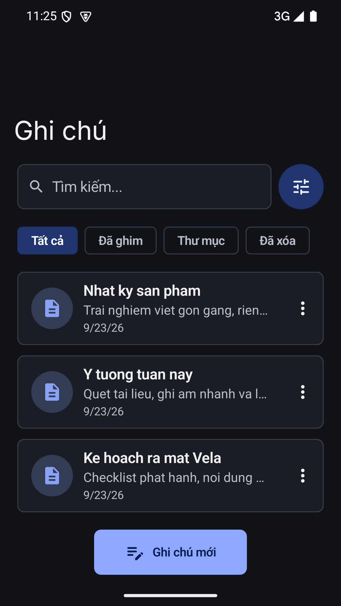

# Vela

**Open. Write. Done.**

Vela là ứng dụng ghi chú Android ưu tiên sử dụng ngoại tuyến và lưu dữ liệu trên thiết bị. Được xây dựng bằng Kotlin và Jetpack Compose, Vela kết hợp soạn thảo ghi chú, checklist Markdown, ảnh, tài liệu scan và ghi âm trong một giao diện gọn nhẹ, có chế độ sáng và tối.

## Tính năng

- Tạo và chỉnh sửa ghi chú; tự động lưu với debounce 500 ms.
- Định dạng Markdown và checklist `- [ ]` / `- [x]`, kèm tiến độ hoàn thành trên danh sách ghi chú.
- Tìm kiếm tiêu đề, nội dung và văn bản OCR bằng Room FTS.
- Thêm ảnh từ camera hoặc thư viện và đính kèm tệp.
- Scan tài liệu nhiều trang: nhận diện biên, chỉnh góc, hiệu chỉnh phối cảnh, bộ lọc, xuất PDF và OCR trên thiết bị.
- Ghi âm, tạm dừng/tiếp tục, waveform, tua và điều chỉnh tốc độ phát.
- Ghim ghi chú, xóa mềm và quản lý vòng đời tệp đính kèm.
- Khóa ứng dụng bằng sinh trắc học hoặc phương thức khóa thiết bị, có thời gian tự khóa tùy chọn.
- Giao diện sáng/tối và hỗ trợ khả năng tiếp cận.

Giới hạn hiện tại: tệp tối đa **50 MB**, bản ghi âm tối đa **60 phút**, tài liệu scan tối đa **50 trang**.

## Giao diện

<p>
  
  
  
</p>

Bộ ảnh, biểu tượng và video giới thiệu nằm trong [`release-assets/google-play/`](release-assets/google-play/README.md).

## Công nghệ

- Kotlin, Jetpack Compose và Material 3.
- Room / FTS cho dữ liệu và tìm kiếm; DataStore cho tùy chọn.
- Hilt, Coroutines và ViewModel.
- CameraX, OpenCV và ML Kit Text Recognition cho camera, scan và OCR.
- Media3 cho phát âm thanh; AndroidX Biometric cho khóa ứng dụng.
- JUnit, Robolectric và Compose UI tests.

## Chạy dự án

Dự án Android nằm trong thư mục **`code/`**. Mở thư mục này bằng Android Studio.

Yêu cầu:

- JDK 17 trở lên, tương thích với Gradle/Android Gradle Plugin được khai báo trong dự án.
- Android SDK Platform 36 và Android SDK Build Tools tương ứng.
- Thiết bị hoặc emulator Android 7.0 / API 24 trở lên.

Thiết lập đường dẫn SDK qua Android Studio, biến môi trường `ANDROID_HOME`, hoặc `code/local.properties`. File `local.properties` chỉ dùng trên máy cá nhân và được Git bỏ qua.

Build trên Windows:

```powershell
cd code
.\gradlew.bat :app:assembleDebug
```

Build trên macOS/Linux:

```bash
cd code
bash ./gradlew :app:assembleDebug
```

APK debug được tạo tại `code/app/build/outputs/apk/debug/app-debug.apk`.

## Kiểm thử

Chạy từ thư mục `code/` trên Windows:

```powershell
.\gradlew.bat :app:assembleDebug :app:testDebugUnitTest :app:lintDebug
```

Khi đã kết nối thiết bị hoặc khởi động emulator:

```powershell
.\gradlew.bat :app:connectedDebugAndroidTest
```

Trên macOS/Linux, thay `.\gradlew.bat` bằng `bash ./gradlew`.

## Cấu trúc repo

```text
code/             Mã nguồn Android, Gradle, tài nguyên và tests
docs/             Đặc tả sản phẩm, kế hoạch, quyết định và checklist phát hành
release-assets/   Ảnh chụp màn hình, biểu tượng và video giới thiệu
.cursor/rules/    Quy ước phát triển của dự án
```

Tham khảo [đặc tả dự án](docs/VELA_CURSOR_SPEC.md), [tiến độ triển khai](docs/VELA_TASKS.md) và [checklist phát hành](docs/VELA_RELEASE_CHECKLIST.md). Tài liệu kế hoạch có thể chứa các tính năng dự kiến cho những phiên bản tiếp theo.

## Quyền riêng tư

Vela không yêu cầu tài khoản và không tích hợp cloud sync, quảng cáo hoặc analytics. Manifest loại bỏ quyền `INTERNET`; dữ liệu ghi chú và tệp đính kèm được lưu cục bộ. Camera và microphone được dùng cho các thao tác chụp/scan và ghi âm.

Khóa ứng dụng kiểm soát truy cập giao diện; cơ sở dữ liệu hiện chưa có lớp mã hóa riêng. Khi bật App Lock, ứng dụng dùng `FLAG_SECURE` để hạn chế ảnh chụp màn hình, ghi màn hình và xem trước trong Recent Apps.

## Trạng thái và giấy phép

Phiên bản hiện tại trong cấu hình Android: **0.1.0**. Repo bao gồm mã nguồn, tài liệu và tài nguyên giới thiệu; cache build, cấu hình máy và khóa ký không được đưa vào Git.

Repo chưa khai báo giấy phép cho mã nguồn ứng dụng. Giấy phép font Inter được giữ tại [`code/licenses/Inter-OFL.txt`](code/licenses/Inter-OFL.txt).
